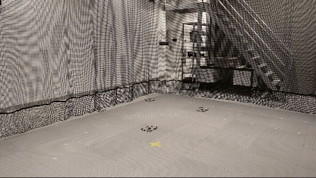
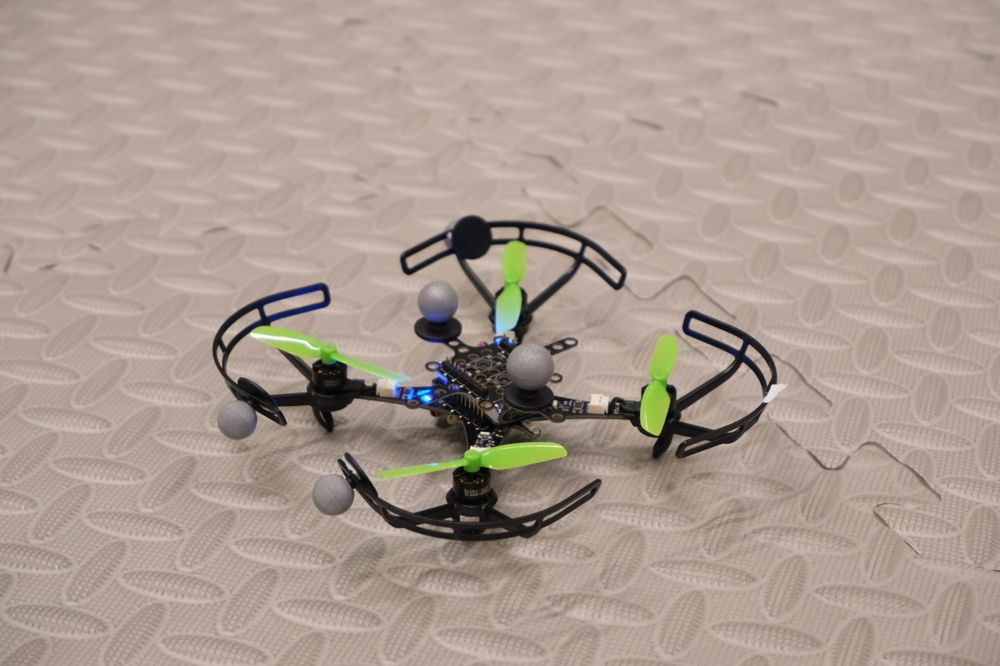

# Crazyflie + OptiTrack Swarm Control

Python scripts for flying one or more Crazyflie drones using OptiTrack (Motive) motion capture as the position source. Motive streams each drone's pose over NatNet. The scripts forward it to the drone's onboard controller and run single-drone and swarm flights.

> This repository is a step-by-step introduction to the lab's Crazyflie and OptiTrack setup. It is meant as a starting point: once you are familiar with the system, you can build on it for your own research and projects in the lab.



## Repository Structure

```
crazyflie-optitrack/
├── requirements.txt
├── media/                 # Contain all photos and GIFs
├── docs/                  # documentations for each script and their features 
└── mocap_crazyflie/
    ├── mocap.py           # Shared NatNet/Motive handling, pose forwarding, tracking checks
    ├── drone_pose.py      # Print one drone's pose from Motive (no drone connection)
    ├── go_to.py           # Fly one drone to a target point, hover,  and land
    ├── swarm_hover.py     # Swarm takeoff/hover/land (sequential or parallel), optional: square flight
    ├── swarm_square.py    # 4-drone pattern in absolute Motive coordinates
    ├── swarm_status.py    # Status monitor for the swarm
    ├── cf_power.py        # Power on/off/reboot multiple drones over Crazyradio
    └── PythonClient/      # NatNet SDK files go here (not included, see below)
```

## Hardware Requirements

| Item     | Tested version                  |
|----------|---------------------------------|
| Drone    | Crazyflie 2.1 Brushless         |
| Firmware | firmware-cf21bl-2026.08         |
| Radio    | Crazyradio 2.0 - 5.5.uf2        |
| Markers  | 4-5 passive markers per drone   |
| Mocap    | 6 OptiTrack  cameras - PrimeX22 |



## Software Requirements

| Item                       | Tested Version          |
|----------------------------|-------------------------|
| Motive                     | Motive:Body 3.3.4.1     |
| NatNet SDk (Python Client) |                         |
| Python 3.12                | 3.12.15 on macOS        |
| cflib                      | 0.1.34                  |
| cfclient                   |                         |

## Installation

### 1\. Clone and set up a virtual environment
```
git clone https://github.com/<your-username>/crazyflie-optitrack.git
cd crazyflie-optitrack
python3.12 -m venv .venv
source .venv/bin/activate
pip install -r requirements.txt
```

### 2\. Crazyradio USB permissions
The Crazyradio permissions are different for different operating systems. On MacOS just plug in and go on. Follow the instructions [getting started with crazyradio](https://www.bitcraze.io/documentation/tutorials/getting-started-with-crazyradio-2-0/) for your operating system. 

### 3\. Add the NatNet SDK files
These files are not included in this repository because NaturalPoint's license does not allow redistributing them.
1. Download the NatNet SDK from OptiTrack: [OptiTrack NatNet SDK](https://optitrack.com/support/downloads/developer-tools.html)
2. Copy the SDK's Python sample folder into mocap_crazyflie/PythonClient/

## Motive Setup

In Motive:
1. **Rigid bodies:** Create one rigid body per drone and take note of each unique Streaming ID.
2. **Orientation:** Align each rigid body's orientation with the drone's body frame (X forward). Orientation is sent to the Kalman filter, so a wrong pivot or rotation will cause bad flight.
3. **Streaming settings (Data Streaming pane):**
   * Broadcast Frame Data: **On**
   * Transmission Type: **Unicast**
   * Up Axis: **Z Up**
   * Local Interface: <the Motive PC's IP on the shared network>
   
> The drones will be sharing the same global coordinate system as Motive. The coordinates are set when calibration has been done in Motive. Note that different calibrations might have different orientations and zero positions. 

## Network Setup

* The laptop running these scripts and the Motive PC must be on the same network / subnet.
* The firewall on both machines must allow UDP ports 1510 and 1511 (NatNet).
* `CLIENT_IP` = your laptop’s IP, `SERVER_IP` = the Motive’s PC’s IP

## Crazyradio setup: using multiple Crazyradios

Using one crazy radio dongle only supports 2 crazyflie communications without interruption. Make sure you have set the frame rate in Motive to 100 - 120  frames/s. Otherwise, the number of packets will exceed the maximum limit of each Crazyradio dongle. For the given frame rates, you will still need to have one dongle per 2 drones. 

When the swarm is split across more than one Crazyradio, put the drones on each radio on their own channel. This spreads the radio traffic and reduces packet loss.

What to do:
1. In the Crazyflie client (cfclient), set each drone's channel and address. See the [Bitcraze cfclient user guide](https://www.bitcraze.io/documentation/repository/crazyflie-clients-python/master/userguides/userguide_client/).
2. Your configuration should look like something like the below example:
```
    DRONE_CONFIG = {
    'radio://1/60/2M/E7E7E7E7EA': 2,   ## radio 1, channel 60
    'radio://1/60/2M/E7E7E7E7EB': 3,
    'radio://0/80/2M/E7E7E7E7EC': 4,   ## radio 0, channel 80
    'radio://0/80/2M/E7E7E7E7E8': 5,
}
```

> URI format: `radio://<radio number>/<channel>/<data rate>/<address>` - **Radio number:** which Crazyradio to use (0, 1, …), in the order the radios are detected automatically.
> - **Channel:** 0–80. Use a different channel for each radio. 
> - **Address:** must be unique for every drone.
> - **Data rate**: If it is set to 2M, make sure to separate the channels by 2 numbers, e.g. two drones on channel 60 and the other two should be on channel 62. 
> - **Last number**The number after each URI is the drone's Motive Streaming ID.

## Configurations

Each script has a SETTINGS section at the top. Edit:

| Setting                                   | What to do                                                   |
|-------------------------------------------|--------------------------------------------------------------|
| `DRONE_CONFIG`                            | `{ radio URI : Motive Streaming ID }`, one entry per drone - Order = flight order where relevant - add the radio URI and the rigid body’s ID from Motive |
| `URI` / `DRONE_ID`                        | Single-drone scripts (in `go_to.py` and `drone_pose.py`) - add the drone URI and their corresponding ID from Motive’s rigid body |
| `CLIENT_IP`, `SERVER_IP`                  | Add the IP addresses, see Network Setup above for more information |
| `X_LIMITS`, `Y_LIMITS`, `Z_LIMITS`        | Safe flight box in Motive coordinates (m). Keep these well inside the tracked volume<br>Note: These are currently set for the capture volume of AIM BeyonD Research Lab |
| `TAKEOFF_HEIGHT`, `FLIGHT_HEIGHT`, speeds | Flight parameters                                            |

## Usage

All commands run from mocap_crazyflie/ with the virtual environment active.
### Recommended order for a first session - to get familiar with the concepts
```
# 1. Wake the drones - (soft on)
python3 cf_power.py on

# 2. Check batteries
python3 swarm_status.py --show battery

# 3. Check Motive is streaming the right rigid body - good to check if streaming is working
python3 drone_pose.py

# 4. Check mocap vs onboard estimate - or run without any options to see full satus of the drone
python3 swarm_status.py --show pose

# 5. Single-drone flight - check if the setup works well
python3 go_to.py

# 6. Swarm hover - check if swarm works well
python3 swarm_hover.py

# 7. Swarm pattern - a fun demo :)
python3 swarm_square.py
```

## Scripts 

| Script | What it does | Read before running |
|---|---|---|
| `drone_pose.py` | Prints x, y, z and quaternion for one rigid body | |
| `go_to.py` | Takeoff → fly to target → hover → land (single drone) | |
| `swarm_hover.py` | LED check → estimator reset → arm → hover → land. Switch between sequential and parallel in `__main__` | [swarm_hover doc](docs/swarm_hover.md) |
| `swarm_square.py` | Drones fly from anywhere to their start points (staggered transit heights), then run the pattern in parallel. Requires exactly 4 drones | [swarm_square doc](docs/swarm_square.md) |
| `swarm_status.py` | Status snapshot or live view (`--watch`) | |
| `cf_power.py` | `on`, `off`, `shutdown`, `reboot`, `cycle`; target with `-d` (indices) or `-u` (URIs) | |
| `mocap.py` | A motion capture helper for all of the other scripts | [mocap doc](docs/mocap.md) | 


## Safety

* **Test with one drone first**, inside a net.
* Set the flight-box limits for **your** space. The defaults are for AIM BeyonD Lab .
* **Tracking loss** lands the affected drone. In swarm scripts, an error lands all drones.
* **Ctrl-C** lands all drones.
* Check batteries before flying `swarm_status.py` flags resting voltage below 3.5 V.
* Keep drones at least ~0.3 m apart on the floor.

## Things to watch out for

* `Z_LIMITS` 
* `swarm_square.py` is hardcoded for 4 drones
* Every Motive frame is forwarded to every drone. With several drones on one Crazyradio, a high Motive frame rate may congest the radio link.

## Acknowledgements 

* [Bitcraze](https://www.bitcraze.io/): cflib and its examples, which the estimator reset and swarm structure are based on.
* [OptiTrack / NaturalPoint](https://www.optitrack.com/support/downloads?cat=developer-tools): NatNet SDK
* AIM BeyonD Research Lab / Heriot-Watt University

## License 

This project is licensed under the [GNU General Public License v3.0](LICENSE).

It uses [cflib](https://github.com/bitcraze/crazyflie-lib-python) by Bitcraze, which is also licensed under GPLv3. Parts of the estimator reset and swarm flow are adapted from the cflib examples.

The OptiTrack NatNet SDK files are **not** included in this repository and are covered by NaturalPoint's own licence ([OptiTrack Plugins EULA](https://www.optitrack.com/about/legal/eula.html)).