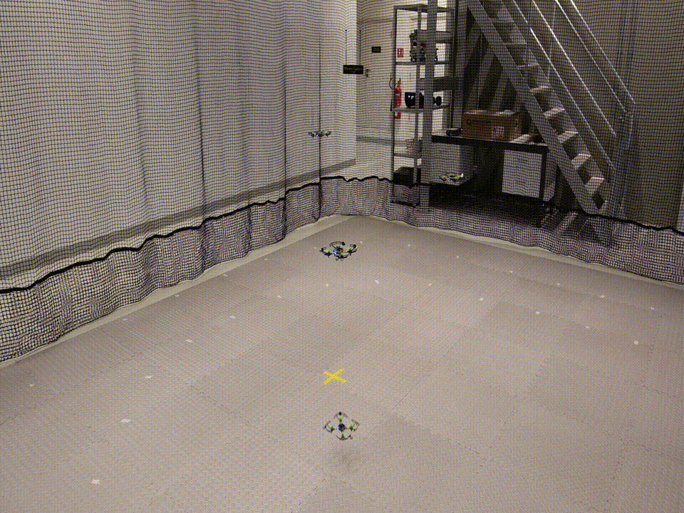

# `swarm_square.py`: 4-drone pattern flight in absolute coordinates

`swarm_square.py` flies four drones through a coordinated pattern using absolute positions in the Motive world frame. The drones can be placed anywhere in the flight area. The script flies each one to its own start point, one at a time, using a different height for each so their paths never cross. Then all four fly the pattern together and land.

* **Placement:** drones on the floor inside the flight area, at least ~0.3 m apart.
* **Height:** the ceiling and the tracked volume reach above the highest transit height (1.10 m with the defaults).

## Flight sequence 

Mocap check → connect → start forwarding → LED check → reset estimators → compare estimate vs mocap → arm → check supervisor → phase 1 → phase 2 → pattern → land → clean up 

1. **Validate:** check every waypoint and transit height against the flight volume, and check that start points are unique. If any check fails, stop before anything connects.
2. **Start NatNet:** connect to Motive and start receiving poses.
3. **Mocap check:** wait until all four drones are visible in Motive.
4. **Connect:** open the radio link to every drone.
5. **Start forwarding:** send each drone's Motive pose to its Kalman filter.
6. **LED check:** turn all LEDs on for 2 s, then off.
7. **Reset estimators:** switch to the Kalman filter and wait until it settles on the mocap data.
8. **Compare estimate vs mocap:** print each drone's onboard estimate next to its mocap position. They should match within a few cm.
9. **Arm:** send the arming request to every drone.
10. **Check supervisor:** print each drone's flags and confirm `is_armed` and `can_fly`.
11. **Phase 1, one drone at a time:**
    1. Take off straight up to the drone's own transit height.
    2. Wait until mocap confirms it is there.
    3. Fly horizontally to above its start point.
    4. Wait until mocap confirms it is there.
12. **Phase 2, one drone at a time:** descend vertically to the start point at `FLIGHT_HEIGHT` and wait until mocap confirms it is there.
13. **Pattern, all drones together:** each drone flies the rest of its waypoint sequence.
14. **Land:** all drones land together.
15. **Clean up:** stop forwarding poses, then close the radio links and NatNet.

## Transit heights: how drones avoid each other

Each drone gets its own transit height. The first drone in `DRONE_CONFIG` gets the highest one and the last gets the lowest:
```
transit_height = TRANSIT_BASE + TRANSIT_SPACING × (number_of_drones − 1 − position)
```

With the defaults:
| Drone (order in DRONE_CONFIG) | Transit height |
|-------------------------------|----------------|
| 1st                           | 1.10 m         |
| 2nd                           | 0.95 m         |
| 3rd                           | 0.80 m         |
| 4th                           | 0.65 m         |
Why this keeps paths apart:
* **Take-off:** when a drone takes off, every drone already in the air is **higher**, so it stops below them.
* **Moving to the start point:** each drone moves at its own height, so no two drones share a horizontal level.
* **Descending:** every drone drops vertically over its own start point, and the start points are different, so nothing is in the way.


## Limitations

* **Exactly four drones.** `SEQUENCES` uses `uris[0]–uris[3]`. With fewer drones the script crashes on start with IndexError. With more, the extra drones have no sequence.
* **Downwash.** During phase 1 a drone can pass 0.15 m (`TRANSIT_SPACING`) below a drone that is already hovering. Crazyflie downwash reaches further than that and can destabilizes the lower drone. If you see wobble during phase 1, increase `TRANSIT_SPACING`. Raise Z_LIMITS and the ceiling check to match.

  

> NOTE: The `TRANSIT_SPACING` and `TRANSIT_HEIGHT` were set to the values due to the fact that the z limit of the lab setup is different in different positions, and depending on the start position, the z limit could not reach what is given in the script. 
> NOTE: This still has not been tested to confirm if it is only due to downwashing or if mocap errors contribute as well. 
* **Error timing in the pattern.** `parallel_safe` waits for every drone to finish its sequence before raising. If one drone loses tracking mid-pattern, it stops, but the others finish their sequences before all drones are told to land.
* **No crossing check.** Custom patterns are not checked for crossing paths.
* **Fixed landing time.** Landing takes 2 s. That's fine from 0.5 m, but increase it in `land()` if you raise `FLIGHT_HEIGHT`.
